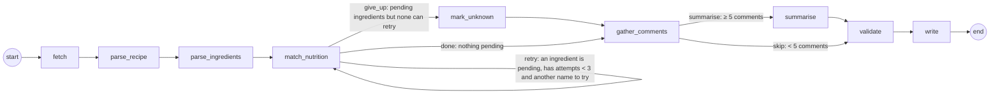

# Recipe Research Agent

Milestone: AI Workflows, Agents and Evals. A LangGraph agent takes one recipe URL and returns a finished
dataset record. It:

- scrapes the page and parses the recipe and ingredients;
- looks up nutrition through an MCP tool, retrying the lookups that fail under a hard cap;
- records unmatched ingredients as unknown and never estimates them;
- summarises what cooks said when there are enough comments;
- ends every run in a declared terminal state with a reason.

It was run over 25 recipes in one category (**Dessert**). An n8n workflow compiles the dataset into a PDF and drafts
an email that a human must approve before it is sent.

## The three numbers

| Setting | Value | Where it is enforced |
|---|---|---|
| **Retry cap** | **3** nutrition lookups per ingredient | `recipe_agent/config.py` `RETRY_CAP`; the router `route_after_match` stops retrying at 3; `validate` rejects any record with more |
| **Comment threshold** | **5** top-level cook comments | `COMMENT_THRESHOLD`; the router `route_after_comments` sends fewer than 5 to `skip` |
| **Card word cap** | **60** words | `CARD_WORD_CAP`; enforced in code by `cook_notes.enforce_word_cap` (claims are added only while the card stays ≤ 60 words), and checked again in `validate`. Never left to a prompt |

## Results (25 dessert recipes)

| | |
|---|---|
| Runs ending in a declared terminal state | **25 / 25** (2 `complete`, 23 `complete_partial`, 0 failed) |
| Ingredient lines | 309 |
| Matched to a USDA food id | **263 (85.1%)**: 133 on the first query, 117 on the second, 13 on the third |
| With a gram weight and nutrition | 241 (78.0%) |
| Unknown | 46: 7 hit the 3-attempt cap; 39 stopped earlier because no other name was left to try |
| Matched but no gram weight (left out, not estimated) | 22 |
| Cook notes cards | 17 produced, 8 skipped (fewer than 5 comments) |
| Highest attempt count on any ingredient | 3 (cap respected) |

Outputs: [`output/dataset.json`](output/dataset.json) (also `.jsonl`, and one file per recipe in `output/records/`),
[`output/recipe_dataset.pdf`](output/recipe_dataset.pdf) and the run log [`output/logs/run_log.jsonl`](output/logs/run_log.jsonl).

## The graph



**Nodes.** Each node has one job and can be tested on its own (`tests/test_graph.py` calls each one directly).

| Node | Job |
|---|---|
| `fetch` | Get the page (live first, then a pinned snapshot), then **sanitise it before it enters state**: keep only the schema.org Recipe JSON-LD (allow-listed keys) and each comment's id and text, with names, handles, emails, links and phone numbers removed |
| `parse_recipe` | Read the Recipe JSON-LD. Assigns `recipe_id` (`rcp_` + sha1 of the canonical URL) and records the source URL, title, category and servings |
| `parse_ingredients` | Parse each line into quantity, unit, size word, a mass stated in the line, and a clean name. Builds each ingredient's query plan: the recipe's own words, then aliases |
| `match_nutrition` | One lookup round. For every pending ingredient that can still retry, it calls the MCP `search_foods` tool with the next query and judges the result: accept, reject as ambiguous, or reject as not close. On accept it calls `get_food` and works out grams from the recipe or USDA portion weights |
| `mark_unknown` | Mark ingredients that are still pending as `unknown`, with the reason and the queries tried |
| `gather_comments` | Turn the sanitised comments into the comment list. Only top-level comments count; author replies are dropped |
| `summarise` | Build the cook notes card. Every claim carries its count and comment ids, and the 60-word cap is enforced in code |
| `validate` | Build the record and check every rule below. Picks the terminal state |
| `write` | Write `output/records/<recipe_id>.json` (or `output/failures/…`) and log the terminal state and node path |

**Two conditional edges, both reading only state.** They are `route_after_match` and `route_after_comments` in
`recipe_agent/nodes.py`. A fetch or parse failure records its terminal state, and the remaining nodes pass
through, logged as `<node>:skipped`, so the graph keeps exactly these two branches.

**Terminal states**, declared up front in `recipe_agent/state.py` (`TerminalState`):

| State | Meaning |
|---|---|
| `complete` | Record written; every ingredient has a food id and a gram weight |
| `complete_partial` | Record written; some ingredients have no nutrition. The reason gives the counts: unknown, hit the cap, no gram weight |
| `failed_fetch` | No source could deliver the page |
| `failed_parse` | No Recipe with ingredients on the page |
| `failed_validation` | The record broke a dataset rule; nothing written to the dataset |

**State.** All data moves through the typed schema `RecipeState` (`recipe_agent/state.py`). It holds:
- `url`, `raw_page` (sanitised) and `page_provenance`
- `recipe` and `ingredients` (each with `status`, `attempts`, `queries_tried`, `attempt_log` and `food_id`)
- `retry_round`, `nutrition`, `comments` and `cook_notes`
- `validation`, `record`, `terminal` and `node_path`

Services (the page fetcher, the MCP client, the summariser and the logger) are injected through LangGraph's runtime
context. No data passes through them between nodes.

## Nutrition record rules

- **Every number traces to a food id.** Each ingredient carries `food_id` (a USDA SR28 NDB number),
  `food_description`, `grams`, a `gram_basis` that says where the grams came from, and its nutrient contribution. Each
  recipe carries `recipe_id`, `source_url` and provenance: where the page came from, the hash of the original page,
  and the nutrition source.
- **Grams are never estimated.** They come from one of three places:
  1. A mass written in the recipe line, such as `2 cups (400g)` or `2 (21-ounce) cans`.
  2. A mass unit converted with exact constants.
  3. A USDA household portion of the matched food, such as `1 cup, packed = 220 g`, used only when its qualifier
     matches the recipe text.

  Anything else gets no grams, with the reason. That covers `2 eggs` with no size, heaping cups, ranges like
  `4-5 cups`, and "to taste".
- **Unmatched means unknown.** An unknown ingredient keeps `food_id: null`, `grams: null` and `nutrients: null`, with
  `unknown_reason` and `queries_tried`. The recipe's nutrition then says `complete: false` with the count, for example
  *"Partial: 7 of 15 ingredients have no nutrition (4 unmatched food, 3 matched but no gram weight); totals cover the
  other 8 only."*
- **Alias rules.** Ambiguous plain names stay unknown on purpose: "milk" (fat level not stated), "vegetable oil",
  "greek yogurt", "sea salt", "kosher salt". A same-food alias whose physical form differs carries
  `volume_portions: false`, so its cup weights are never used. Example: almond flour is matched to blanched almonds
  for nutrients, but almonds' cup weight does not apply to flour.

## MCP tool

`recipe_agent/nutrition_mcp.py` is an MCP server (Python SDK 2.x, stdio). It serves the USDA SR28 food table
through two tools:

- `search_foods(query, limit)` returns ranked candidates.
- `get_food(food_id)` returns nutrients per 100 g and the USDA portion weights.

The agent launches the server as a subprocess and talks to it only through `recipe_agent/mcp_client.py`.
`tests/test_mcp_server.py` does a real stdio round trip.

How a lookup is retried, using the brief's example (it is in the tests and the fixture page):
`1 cup toor dal` → `toor dal` (no candidates) → `arhar dal` (no candidates) →
`Pigeon peas (red gram), mature seeds, raw` → matched to food 16101 on attempt 3 of 3.

A search hit is accepted only if its ranking cost is ≤ 1.0 and it is not tied with a different food. So "milk"
does not silently become sheep's milk, and "raisins" is not a coin toss between seeded and seedless. A tool error
counts as an attempt and the same query is retried.

## Cook notes card

- **Threshold.** A card is written only when there are ≥ 5 top-level comments. Below that the record says
  `skipped_below_threshold` with the count.
- **Format.** For example: *"Cook notes (19 comments): 3 of 19 made it and liked it. …"*. Every claim is
  "N of M …", and the record lists the comment ids behind each claim.
- **Groq summariser (used when `GROQ_API_KEY` is set).** Calls Groq's OpenAI-compatible chat API (default model
  `openai/gpt-oss-120b`, override with `GROQ_MODEL`) with a JSON-schema response format, falling back to JSON mode
  for models without structured outputs. The model only proposes claims and comment ids; the same gate then drops
  ids that are not real comments, recounts from the ids, requires at least 2 comments per claim and applies the
  60-word cap in code. Covered by a test with a mocked Groq endpoint; it has not been run against the live API here.
- **Fallback summariser (`themes-v2`).** Deterministic, used when no Groq key is set (and for the committed
  evaluation run). It counts a comment for a theme only when one sentence is a first-hand report: not a question,
  a plan ("can't wait to try"), someone else's cooking ("my grandma made…") or negated.

## No PII anywhere

Commenter names, handles, avatars and profile links are removed in `fetch`, before anything enters state.
`recipe_agent/sanitize.py` and `recipe_agent/pii.py` work in four layers:

1. Names in comment-author blocks, "Reply to X" labels and JSON-LD persons are redacted from comment text.
2. A capitalised word after a greeting ("Hi Katie") is treated as a name.
3. Given names from a gazetteer are redacted, unless the word is common English or a food word.
4. Regexes catch emails (including "name at domain dot com", which really appeared in a comment), phone numbers
   and @handles.

Raw pages are cached in `.cache/` (git-ignored) and never committed. The run log holds only URLs, ids, node names,
counts and reasons. `validate` also refuses any record in which the PII patterns fire.

## Persistence

Each recipe is one LangGraph thread (`thread_id` = run label + URL hash), checkpointed to
`output/checkpoints.sqlite` with `AsyncSqliteSaver` and `durability="sync"`. Running the same command again resumes
any unfinished thread from its last completed node and skips finished ones.

## Data sources: what is real and what had to change

- **Recipe pages.** The fetcher tries the live URL first. This sandbox's network policy blocks recipe sites, so every
  page in this run came from the fallback: a public snapshot of the same URL captured by the open-source
  [recipe-scrapers](https://github.com/hhursev/recipe-scrapers) project (MIT, `tests/test_data`), pinned to commit
  `e7892149…`. The mapping is in `data/snapshot_index.json`. These are real pages with real comments; the record's
  `provenance.page_source` says `snapshot`. On a machine with open internet the same command fetches live, and
  `--fetch-mode live` refuses snapshots.
- **Nutrition data.** The USDA FoodData Central API is also blocked here. The data is **USDA SR28** (2015), the
  release FoodData Central later absorbed as "SR Legacy", taken from the npm package `fda-nutrient-database@1.0.2`
  and committed in `data/sr28/` (US government data, public domain). Food ids are SR28 NDB numbers. Its
  abbreviated file has only two household portions per food. That is the main reason 22 matched ingredients have no
  gram weight.
- **Recipes.** 25 English pages with `recipeCategory` = Dessert, listed in `data/recipes.txt`: 17 with ≥ 5 cook
  comments and 8 below the threshold, so both branches are exercised.

## Evaluation ("before you submit")

Every report is generated by a script in `evals/`, and every script ran against the final code and data.

| Check | Result | Report |
|---|---|---|
| All 25 runs terminated inside the cap with required fields; match rate; every unmatched ingredient with the queries tried | 25/25 pass; 85.1% matched; 46 unknown listed with their queries | [01_batch_check.md](evals/reports/01_batch_check.md) |
| One recipe per path, node path logged, compared with a prediction written from the inputs | 5/5 went where expected (see the path list below) | [02_paths.md](evals/reports/02_paths.md) |
| Interrupt a run, resume from the checkpoint, compare with an uninterrupted run | Real `SIGKILL` mid-run, then the same command again: resumed at `match_nutrition`, no re-fetch, **record byte-identical**. A crash injected inside the retry loop: also identical | [03_resume.md](evals/reports/03_resume.md) |
| Hand-check 3 recipes' nutrition against their food ids | Recomputed from the raw `ABBREV.txt` line of each food id: every gram weight and nutrient matches (largest difference 0.009, rounding) | [04_nutrition_handcheck.md](evals/reports/04_nutrition_handcheck.md) |
| Trace 10 cook notes claims to comment ids | **37 of 41** cited comments support their claim; **7 of 10** claims fully supported, 3 overstate their count by 1–2 | [05_claim_trace.md](evals/reports/05_claim_trace.md) |
| PII scan across state dumps, dataset, outputs (PDF text, emails) and logs | **0 unexplained hits** against 514 commenter-name strings taken from the original pages. The explained hits are blog brand names, food words and `example.com` placeholders, each shown with context | [06_pii_scan.md](evals/reports/06_pii_scan.md) |
| n8n hand-off end to end | Reject: nothing sent. Approve: one email with the PDF (byte-identical to `output/recipe_dataset.pdf`) | [07_n8n_handoff.md](evals/reports/07_n8n_handoff.md) |

Paths covered by check 2:

- A: retry, then all matched, then summarise.
- B: retry, hit the cap, give up, then summarise.
- C: retry, hit the cap, give up, then skip the card.
- D: give up below the cap (no alias left), then skip the card.
- E: fetch failure.

The "no retry at all" route exists in the graph, but none of the 25 recipes takes it: every recipe has at least one
ingredient, such as `baking powder` or `all-purpose flour`, whose plain name needs its alias.

**How the claim trace changed the summariser.** The first version matched keywords per comment. On the first trace
roughly 30 of 48 cited comments (about 60%) supported their claim, by my reading at the time; that pass was
not saved as a verdict file. The failures were questions ("Can this be made…?"),
plans, other people's cooking, "looks delicious", and recipe-author replies that sites do not mark as the author's.
The fixes were sentence-level first-hand matching and counting only top-level comments. After them, 37 of 41
comments support their claims. The 4 that still don't are two people who made only the frosting, one family
version of the recipe, and one essay about sugar.

## Run it

```bash
git clone https://github.com/imnashraf/recipe-research-agent && cd recipe-research-agent
python -m venv .venv && . .venv/bin/activate
pip install -r requirements.txt
export GROQ_API_KEY=...                               # optional: Groq cook notes

pip install -r requirements-dev.txt                   # adds pytest/pypdf/aiosmtpd
python -m pytest -q                                   # 51 tests: nodes, routers, graph paths, resume, MCP, PII, card cap, API
python -m recipe_agent.batch                          # 25 recipes -> output/ (resumable; re-run to resume)
python -m recipe_agent.batch --url <recipe-url>       # one recipe
python -m recipe_agent.report                         # output/recipe_dataset.pdf

python evals/check_batch.py && python evals/path_check.py && python evals/resume_check.py \
  && python evals/nutrition_handcheck.py && python evals/trace_claims.py && python evals/pii_scan.py
```

### n8n hand-off

`n8n/recipe_dataset_handoff.json` is generated by `n8n/build_workflow.py`. The flow is:

1. **Webhook** (`POST /webhook/recipe-dataset-handoff`, call it when a batch finishes).
2. **Get dataset summary** and **Compile PDF**, both HTTP calls to `python -m recipe_agent.report_server`.
3. **Draft email**.
4. **Ask approver**: an email with the draft, the PDF and a signed approval-form link.
5. **Wait for human approval**: an n8n form with Approve / Reject and an optional edited body.
6. **Approved?** If yes: attach the PDF and **Send dataset email**. If no: *Rejected: nothing sent*.

To use it:
1. `python -m recipe_agent.report_server` (port 8765).
2. In n8n, import the workflow and create an SMTP credential named **Recipe agent SMTP**.
3. Replace the `example.com` addresses (sender, approver, recipients) in `n8n/build_workflow.py` and regenerate.
4. Publish the workflow and POST to the webhook.

For a dry run with no real mail, run `python n8n/smtp_sink.py` and point the SMTP credential at
`127.0.0.1:1025`. Messages land in `output/handoff/`. That is how check 7 was run, with n8n 2.42.4 on Node 24.

## Deployment: Railway (backend) + Vercel (frontend) + n8n Cloud

```
Vercel (frontend/)  ──HTTPS──▶  Railway (Dockerfile, FastAPI)  ──stdio──▶  MCP nutrition server (same container)
                                   │  └──▶ Groq API (cook notes)
                                   └──POST webhook──▶  n8n Cloud ──GET /api/summary, /api/report.pdf──▶ Railway
                                                           └── Gmail: approval request ▶ form ▶ approved email + PDF
```

Live frontend: https://recipe-research-agent.vercel.app (Vercel project `recipe-research-agent`, root directory
`frontend`).

**Railway service setup.** New project → Deploy from GitHub repo → `imnashraf/recipe-research-agent`, branch `main`.
Railway finds `railway.json` and the `Dockerfile` at the repo root, so no root-directory setting is needed. Attach a
volume at `/data`, add the variables below, then Networking → Generate Domain.

**Backend (`recipe_agent/api.py`, `Dockerfile`, `railway.json`).** Public read endpoints: `/health`, `/api/config`,
`/api/summary`, `/api/recipes`, `/api/recipes/{id}`, `/api/report.pdf`. Endpoints that spend Groq tokens or send
mail need `Authorization: Bearer $ADMIN_TOKEN`: `POST /api/runs {"url": ...}` (one recipe, progress at
`GET /api/runs/{id}`), `POST /api/batch` (all 25, then the n8n hand-off) and `POST /api/handoff`. On first start an
empty volume is seeded with the committed 25 records.

| Railway variable | Value |
|---|---|
| `GROQ_API_KEY` | your Groq key (never commit it) |
| `ADMIN_TOKEN` | a long random string; you also paste it into the website's Connection panel |
| `DATA_DIR` | `/data`, with a Railway volume mounted at `/data` |
| `N8N_WEBHOOK_URL` | the n8n workflow's **Production** webhook URL |
| `CORS_ORIGINS` | the Vercel site URL, e.g. `https://recipe-research-agent.vercel.app` (default `*`) |
| `GROQ_MODEL`, `FETCH_MODE` | optional |

**Frontend (`frontend/`, Vite + React).** Dashboard, run-a-recipe panel with the live node path, recipe detail with
food ids, gram basis, every lookup attempt and the cook notes card. Set `VITE_API_BASE` to the Railway URL in Vercel
(or enter it under *Connection* in the site). Without a backend it shows the committed snapshot
(`frontend/public/dataset.json`, refresh with `npm run sync-data`).

**n8n Cloud (`n8n/recipe_dataset_handoff_cloud.json`).** Import it, connect a Gmail credential to both Gmail nodes,
set `APPROVER_EMAIL` and `RECIPIENTS` in the *Settings* node, publish, and copy the production webhook URL into
Railway's `N8N_WEBHOOK_URL`. The backend sends its own public URL in the webhook body; the Settings node only
accepts `https://*.up.railway.app` (pin the exact host with `PINNED_HOST`).

## Known limitations

- **The match rate is optimistic for new recipes.** The alias table (`data/aliases.json`) was written while working
  on these 25 recipes. Expect a lower first-time match rate on unseen recipes, until aliases are added or an
  LLM-proposed alias step is plugged into `initial_plan`.
- **The default summariser favours precision over recall and is still imperfect.** 3 of the 10 traced claims
  overstate their count by 1–2. Many real reports are missed, so counts are lower bounds in practice.
- **SR28 has two household portions per food.** Ingredients like "2 eggs" (no size) or "1 cup almond flour" get no
  gram weight, so 23 of 25 recipes are `complete_partial`. That is the intended honest outcome, not a failure.
- Live fetching and the Groq summariser are implemented and unit-tested, but this sandbox could not reach the real
  services. The committed dataset and the claim trace use the deterministic summariser.

## Layout

```
recipe_agent/   state.py (schema + terminal states) · graph.py · nodes.py · api.py · fetch.py · sanitize.py · pii.py
                ingredient_parse.py · matching.py · nutrition_db.py · nutrition_mcp.py · mcp_client.py
                cook_notes.py · batch.py · report.py · report_server.py · run_log.py · config.py
data/           recipes.txt · snapshot_index.json · aliases.json · sr28/ (USDA SR28 abbreviated tables)
evals/          check scripts, claim_verdicts.json, pii_allowlist.json, reports/
n8n/            recipe_dataset_handoff.json (local) · recipe_dataset_handoff_cloud.json · build_workflow.py · smtp_sink.py
frontend/       Vite + React site for Vercel
Dockerfile · railway.json   backend image for Railway (recipe_agent/api.py)
output/         dataset.json(l) · records/ · recipe_dataset.pdf · logs/run_log.jsonl · handoff/*.txt
tests/          pytest suite + a fixture page (toor dal, with planted PII)
```
